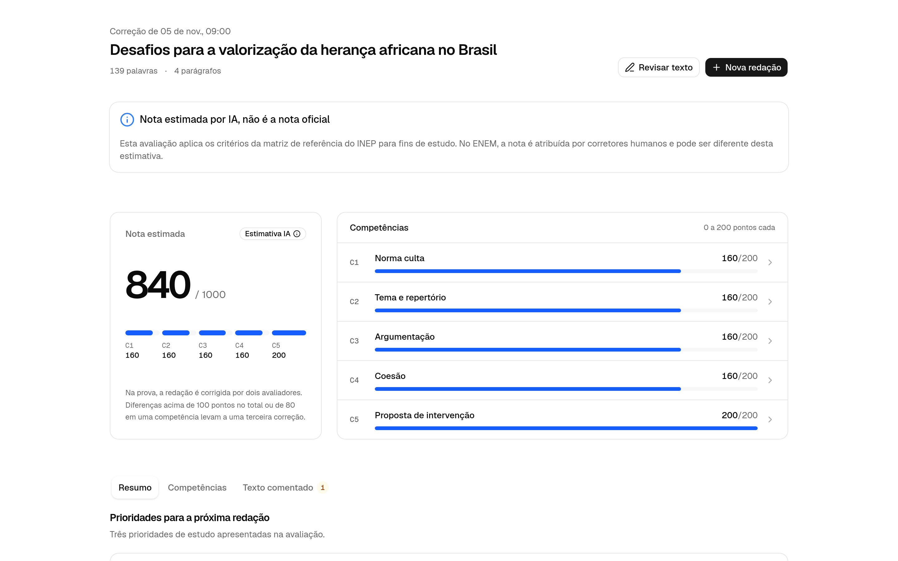
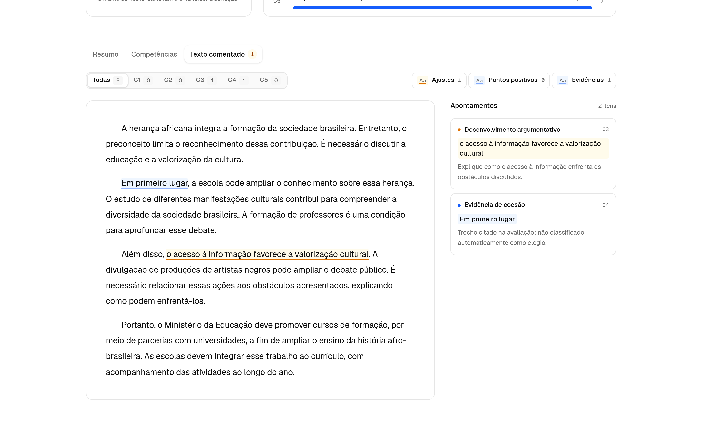
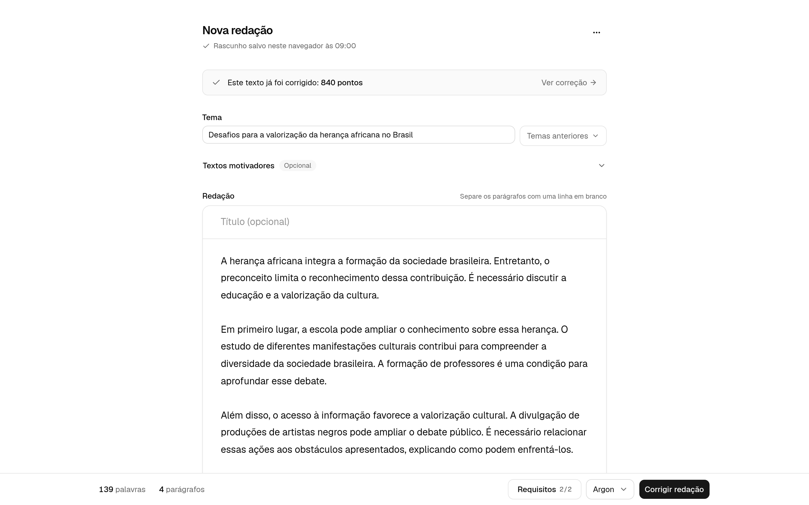

# Cúbico Redação

Corretor de redações do ENEM com IA, ancorado na matriz de referência do INEP. O estudante escreve ou cola a redação, recebe uma **nota estimada por competência (C1–C5)**, comentários ligados a trechos **literais** do próprio texto e prioridades de estudo, e mantém um histórico das correções.

> _English summary:_ ENEM (Brazilian national exam) essay-feedback app. TanStack Start + React on Cloudflare Workers/D1, Google sign-in with Better Auth, and a Gemini-based grader grounded in the official INEP rubric with local retrieval of official commented essays. Model output is schema-validated server-side, quotes are verified against the submitted text, and the total score is computed in trusted code.



| Texto comentado                                                                            | Editor                                            |
| ------------------------------------------------------------------------------------------ | ------------------------------------------------- |
|  |  |

<sub>Capturas do catálogo visual isolado (`bun run visual:dev`), com dados sintéticos.</sub>

## Como usar

1. **Entre** com **Continuar com Google**. Só contas incluídas em `ALLOWED_EMAILS` têm acesso.
2. **Escreva a proposta** no editor:
   - **Tema:** obrigatório. Em **Temas anteriores** você reaproveita um tema já usado.
   - **Textos motivadores:** opcionais, até 20.000 caracteres no total.
   - **Redação:** título opcional, até 30.000 caracteres. Separe os parágrafos com uma linha em branco.
3. **Confira os requisitos** no rodapé. **Tema informado** é obrigatório. **Organização em parágrafos** é só um alerta e espera de 4 a 5 parágrafos.
4. **Escolha o modelo**:
   - **Argon** (Gemini 4 Argon) é o padrão.
   - **3.8 Flash** é mais barato. Se estiver indisponível, o Argon corrige no lugar.
5. **Clique em Corrigir redação.** A correção roda no servidor e abre em `/redacao/:id`.
6. **Leia a devolutiva** em três abas:
   - **Resumo:** nota estimada de 0 a 1000 e prioridades para a próxima redação.
   - **Competências:** nota de C1 a C5 em níveis de 40 pontos, com justificativas, pontos fortes e problemas.
   - **Texto comentado:** apontamentos destacados no seu texto, filtráveis por competência e por tipo (ajustes, pontos positivos, evidências). Um comentário só ganha destaque quando o trecho citado existe literalmente no texto.
7. **Reescreva**:
   - **Revisar texto** abre uma nova versão no editor, sem alterar a avaliação original.
   - **Nova redação** começa do zero.
8. **Acompanhe a evolução** em **Histórico** (`/historico`): busca por título, filtro por data, média e melhor nota. Ali também dá para excluir uma avaliação.
9. **Ajuste a conta** em **Configurações** (`/configuracoes`):
   - edite o perfil e a foto;
   - ative ou desative **Salvar correções na minha conta**;
   - importe um histórico antigo do navegador;
   - exclua todo o histórico.

O histórico na nuvem só funciona se você ativar essa opção, guarda as 30 avaliações mais recentes por até 90 dias e pode ser apagado a qualquer momento. O rascunho fica só na sessão do navegador. A nota é uma **estimativa gerada por IA**, não a nota oficial do ENEM.

## Destaques técnicos

- **Rubrica oficial governa a nota.** O prompt leva os descritores de nível da cartilha do INEP. Exemplos recuperados (RAG) entram só como contexto pedagógico, nunca como regra de pontuação.
- **Saída do modelo não é confiável por padrão.** Toda resposta passa por Zod (`src/lib/correction.ts`, `src/server/result-validation.ts`). Cada competência só aceita `0, 40, 80, 120, 160, 200`, e o total é recalculado no servidor.
- **Sem citações inventadas.** Trechos citados pelo modelo são conferidos contra o texto enviado (`ensureEvidenceQuotesAreExact`). O que não é encontrado aparece como comentário estrutural, sem destaque falso.
- **Base de conhecimento reproduzível.** Um pipeline em Python (`scripts/cartilhas/`) extrai as cartilhas do INEP de 2018 a 2026 e gera a rubrica canônica e um índice de evidências com página de origem. Detalhes em [docs/knowledge-base.md](docs/knowledge-base.md).
- **Calibração medida.** Benchmark offline e pago, com limite de gasto explícito (`scripts/benchmark/`). Resultados e decisões em [docs/grading-calibration.md](docs/grading-calibration.md).
- **Segurança e custo sob controle:**
  - login Google com allowlist de e-mails;
  - verificação de origem/CSRF e Turnstile opcional;
  - cotas diária e mensal com contabilidade de tokens no D1;
  - limite de correções simultâneas, rate limit por usuário e idempotência por `requestId`.
- **Privacidade.** O texto da redação não vai para logs. O histórico na nuvem é opt-in, com consentimento registrado e retenção aplicada no servidor ([docs/cloud-history.md](docs/cloud-history.md)).
- **UI acessível.** shadcn/ui sobre Base UI, navegação por teclado, tema claro e escuro, layout responsivo e testes com axe/Playwright.

## Stack

| Camada    | Tecnologia                                                                                         |
| --------- | -------------------------------------------------------------------------------------------------- |
| App       | [TanStack Start](https://tanstack.com/start) (React 19, file routes, server functions), TypeScript |
| UI        | Tailwind CSS v4, shadcn/ui + Base UI, Motion, Recharts                                             |
| Runtime   | Cloudflare Workers, D1 (SQLite), R2 (avatares), Rate Limiting                                      |
| Auth      | Better Auth com Google OAuth                                                                       |
| IA        | Gemini via [AI SDK](https://ai-sdk.dev) (`ai`, `@ai-sdk/google`)                                   |
| Dados     | Pipeline Python (PyMuPDF) para as cartilhas do INEP                                                |
| Qualidade | Bun test, ESLint, Playwright + axe, GitHub Actions                                                 |

## Arquitetura

```
Navegador ──► TanStack Start (Cloudflare Worker)
               ├─ server functions autenticadas (src/lib/server-functions.ts)
               │    ├─ sessão + allowlist (Better Auth, D1)
               │    ├─ origem, Turnstile, cotas, concorrência (security/usage.server.ts)
               │    └─ correção (correction-flow.server.ts)
               │         ├─ rubrica INEP + guia de correção (grading-guide.server.ts)
               │         ├─ RAG local das cartilhas (rag.server.ts, data/knowledge)
               │         ├─ Gemini (inference.server.ts)
               │         └─ validação Zod + citações exatas + total no servidor
               └─ D1: usuários, uso/custos, histórico   R2: avatares
```

Estrutura principal:

| Caminho           | Conteúdo                                                                              |
| ----------------- | ------------------------------------------------------------------------------------- |
| `src/routes/`     | rotas (`/login`, `/editor`, `/historico`, `/redacao/:id`, `/configuracoes`)           |
| `src/components/` | telas e componentes de domínio; `ui/` contém os primitivos shadcn                     |
| `src/lib/`        | contratos Zod, view-models e utilitários compartilhados                               |
| `src/server/`     | código só de servidor: auth, segurança, uso, correção, RAG, histórico                 |
| `data/`           | rubrica e base de conhecimento derivadas das cartilhas do INEP (ver [NOTICE](NOTICE)) |
| `migrations/`     | migrations D1 aditivas                                                                |
| `scripts/`        | ingestão das cartilhas, benchmark, smoke tests e deploy                               |
| `visual/`         | catálogo isolado de telas com fixtures sintéticas                                     |

## Rodando localmente

Requisitos: [Bun](https://bun.sh), Node.js 22.18+ e o [CLI `cf` da Cloudflare](https://developers.cloudflare.com/cf/). Para regerar a base de conhecimento, também [uv](https://docs.astral.sh/uv/).

```bash
bun install --frozen-lockfile
cp .dev.vars.example .dev.vars          # preencha os segredos locais
cp .env.cloudflare.example .env.cloudflare   # opcional: configuração da sua conta
bun run db:migrate:local                # D1 local
bun run dev                             # http://127.0.0.1:3000
```

Variáveis em `.dev.vars`:

| Variável                                     | Uso                                                              |
| -------------------------------------------- | ---------------------------------------------------------------- |
| `BETTER_AUTH_SECRET`, `BETTER_AUTH_URL`      | sessão; a URL deve ser igual à origem aberta no navegador        |
| `GOOGLE_CLIENT_ID`, `GOOGLE_CLIENT_SECRET`   | OAuth; callback `http://127.0.0.1:3000/api/auth/callback/google` |
| `ALLOWED_EMAILS`                             | e-mails autorizados, separados por vírgula                       |
| `GEMINI_API_KEY`                             | chave da Gemini API                                              |
| `TURNSTILE_SITE_KEY`, `TURNSTILE_SECRET_KEY` | opcionais                                                        |

Cada correção faz uma chamada paga à Gemini API. As cotas (`DAILY_USER_LIMIT`, `MONTHLY_CORRECTION_LIMIT`, `GLOBAL_CONCURRENT_LIMIT`) limitam o gasto.

### Sem credenciais

O catálogo visual mostra todas as telas e estados com dados sintéticos, sem login e sem chamadas à IA:

```bash
bun run visual:dev   # http://127.0.0.1:3200/visual/index.html
```

## Testes e verificações

```bash
bun test               # unitários: contratos, citações, cotas, acesso, D1, histórico
bun x tsc --noEmit
bun run lint
bun run build
bun run test:visual    # Playwright + axe no catálogo visual (CHROMIUM_PATH opcional)
bun run kb:test        # pipeline das cartilhas (requer os PDFs)
```

A CI ([.github/workflows/ci.yml](.github/workflows/ci.yml)) roda testes, tipos, lint e build sem nenhum segredo.

## Deploy na sua conta Cloudflare

O deploy usa o CLI `cf` e lê a configuração de `cloudflare.config.ts`. Os valores específicos da conta vêm de `.env.cloudflare` ou de variáveis de ambiente: `CUBICO_WORKER_NAME`, `CUBICO_DOMAIN`, `CUBICO_D1_NAME`, `CUBICO_D1_ID`, `CUBICO_R2_BUCKET` e `CUBICO_RATE_LIMIT_NAMESPACE`.

1. Crie o banco D1 e o bucket R2 e registre o ID do banco em `CUBICO_D1_ID`.
2. Cadastre no Google o callback `https://SEU_DOMINIO/api/auth/callback/google`.
3. Crie `.env.production` com os segredos de produção. Fora do git, `DEPLOY_ENV_FILE` aponta para outro arquivo.
4. Rode `bun run db:migrate:remote`, depois `bun run deploy:dry-run`, depois `bun run deploy`.

O script de deploy força `BETTER_AUTH_URL` para o domínio de produção e recusa valores apontando para `localhost`. Ele também recusa o deploy enquanto o ID do D1 for o placeholder local.

## Conteúdo do INEP e aviso

As notas são **estimativas geradas por IA** e não têm vínculo com o INEP. A rubrica, os comentários e as redações de participantes em `data/` vêm das cartilhas oficiais "A Redação no Enem". O expediente das cartilhas permite a reprodução desde que citada a fonte. Esse conteúdo continua de autoria do INEP e dos participantes e não está sob a licença MIT. Veja [NOTICE](NOTICE) e [data/README.md](data/README.md).

## Licença

Código sob a licença [MIT](LICENSE). Conteúdo de terceiros conforme [NOTICE](NOTICE).
